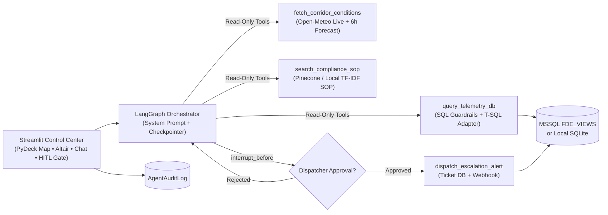

<div align="center">

# 🧊 ColdPulse Ops

### Agentic Cold-Chain Logistics Control Plane & Dispatch Console

[](https://www.python.org/)
[](https://github.com/langchain-ai/langgraph)
[](https://streamlit.io/)
[](https://github.com/atharva081106/Coldpulse-Ops/actions)

*Real-time refrigerated fleet telemetry, live weather corridor risk scoring, SOP compliance RAG, and Human-in-the-Loop (HITL) escalation dispatch.*

</div>

---

## 🎯 Overview

**ColdPulse Ops** is a Forward Deployed Engineering (FDE) AI operations platform built to help logistics dispatchers monitor cold-chain fleets, diagnose temperature excursions, verify Standard Operating Procedures (SOPs), and approve operational escalations—all with strict SQL guardrails and full auditability.

It runs **out-of-the-box in zero-dependency Local Mode** (`SQLite` + local TF-IDF SOP retrieval) or connects seamlessly to **Enterprise Mode** (`SQL Server` + `Pinecone`).

---

## 🏗️ System Architecture



---

## ✨ Key Capabilities

| Capability | Implementation |
| :--- | :--- |
| **Dual-Mode Data Backend** | Auto-selects `MSSQL` (`FDE_VIEWS.VW_ACTIVE_FLEET`) when configured or `LOCAL` (`SQLite` seeded from `data/raw/dynamic_supply_chain_logistics_dataset.csv`). |
| **Strict SQL Guardrails** | `validate_readonly_sql` enforces single-statement `SELECT`/`WITH` queries and blocks `;` injections and mutating/DDL keywords (`INSERT`, `UPDATE`, `DELETE`, `DROP`, `EXEC`, `INTO`). |
| **Multi-Factor Corridor Risk** | `fetch_corridor_conditions` queries Open-Meteo current weather + 6-hour precipitation probability and scores ambient heat/freeze reefer stress (`0–10`). |
| **Multi-Cargo SOP RAG** | Covers Fresh Perishables (`0.0–4.0°C`), Frozen (`≤ -18.0°C`), Biologics/Pharma (`2.0–8.0°C`), Port Diversions (`>7.0`), and Tier 1/2 escalations via Pinecone or local TF-IDF. |
| **Human-in-the-Loop (HITL)** | `interrupt_before=["action_tools"]` pauses before `dispatch_escalation_alert` so dispatchers can approve or reject escalation tickets and webhook notifications. |
| **Live Command Center UI** | KPI command bar, interactive `PyDeck` map with hover tooltips, `Altair` analytics, clickable high-risk triage, token streaming, model switcher, and SOP Policy Manager. |
| **Multi-Provider LLM Routing** | Supports **NVIDIA NIM** (`nvidia/nemotron-3.5-lightning-30b-a3b`, `nemotron-3-ultra-550b-a55b`), **OpenAI**, **DeepSeek**, and **Ollama**. |

---

## 🚀 Quickstart (Local Zero-Config Mode)

### 1. Clone & Install
```bash
git clone https://github.com/atharva081106/Coldpulse-Ops.git
cd Coldpulse-Ops
pip install -r requirements.txt
```

### 2. Configure Environment
Copy `.env.example` to `.env` and set your LLM provider:
```bash
cp .env.example .env
```
Example `.env` for **NVIDIA NIM**:
```env
DATA_BACKEND=AUTO
SOP_BACKEND=AUTO
Agent_llm=NVIDIA
NVIDIA_API_KEY=nvapi-...
NVIDIA_MODEL=nvidia/nemotron-3.5-lightning-30b-a3b
```

### 3. Launch the Console
```bash
streamlit run src/ui.py
```

---

## ☁️ Deploy to Streamlit Community Cloud

1. Open [share.streamlit.io](https://share.streamlit.io) and select **`atharva081106/Coldpulse-Ops`** (`main` branch, main file: `src/ui.py`).
2. Add the following under **Advanced settings → Secrets**:
   ```toml
   DATA_BACKEND = "LOCAL"
   SOP_BACKEND = "LOCAL"
   Agent_llm = "NVIDIA"
   NVIDIA_API_KEY = "your-nvidia-api-key"
   NVIDIA_MODEL = "nvidia/nemotron-3.5-lightning-30b-a3b"
   ```
3. Click **Deploy** to generate your live URL.

---

## 🧪 Testing & Trajectory Evaluations

| Check | Command | What It Verifies |
| :--- | :--- | :--- |
| **Unit & HITL Suite** | `pytest -v tests/test_agent_pipeline.py` | SQL guardrails, T-SQL translation, local telemetry & SOP retrieval, weather scoring, and LangGraph HITL pause/resume. |
| **UI Smoke Test** | `python -c "from streamlit.testing.v1 import AppTest; at = AppTest.from_file('src/ui.py', default_timeout=60); at.run(); assert not at.exception and not at.error"` | Headless verification that the Streamlit dashboard renders without exceptions. |
| **Live Trajectory Eval** | `python scripts/eval_agent.py` | Validates multi-tool `"Domino Effect"` triage and `"Restraint"` no-DB policy answers against the live LLM. |

---

## 📁 Project Structure

```text
├── .github/workflows/
│   ├── ci.yml                 # Automated syntax, AppTest & pytest CI
│   └── deploy.yml             # EC2 SSH deployment workflow
├── data/
│   ├── policy/                # Cold-chain SOP Markdown policies
│   └── raw/                   # Supply chain telemetry dataset (CSV)
├── scripts/
│   ├── eval_agent.py          # Live LLM tool-trajectory evaluation
│   ├── ingest_legacy_data.py  # MSSQL raw table ingestion
│   ├── ingest_sop_pinecone.py # Pinecone SOP indexing
│   └── setup_security_and_view.sql
├── src/
│   ├── prompts/system_prompt.txt
│   ├── agent_tools.py         # Telemetry, weather, SOP, and escalation tools
│   ├── db_backend.py          # Dual MSSQL/SQLite backend & SQL guardrails
│   ├── orchestrator.py        # LangGraph HITL state machine & LLM factory
│   └── ui.py                  # ColdPulse Ops Streamlit Command Center
└── tests/
    └── test_agent_pipeline.py
```
